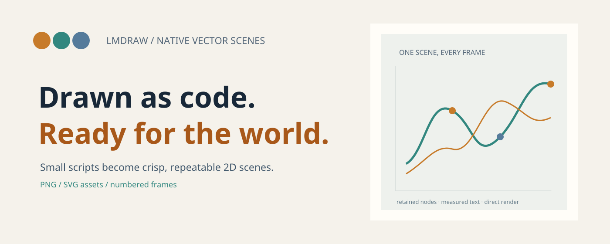
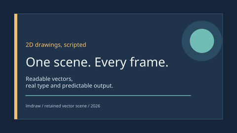
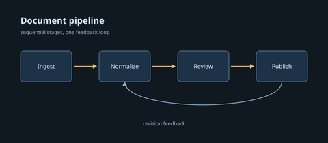
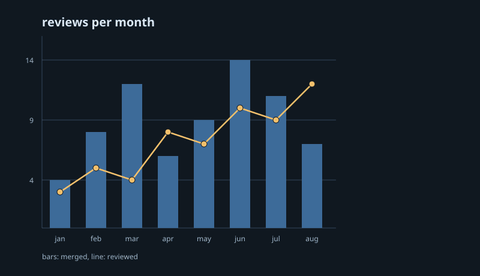
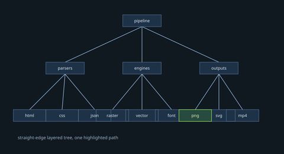
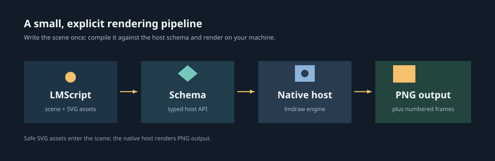

<p align="center">
  <picture>
    <source media="(prefers-color-scheme: dark)" srcset="docs/readme/hero-dark.png">
    <source media="(prefers-color-scheme: light)" srcset="docs/readme/hero-light.png">
    
  </picture>
</p>

**lmdraw turns small lmscript programs into crisp, repeatable 2D scenes, rendered as PNGs and frame sequences.**

[](https://github.com/lmctl-ai/lmdraw/releases)
[](https://github.com/lmctl-ai/lmdraw/actions/workflows/ci.yml)

## Made with lmdraw

| Type and gradients | Flow diagrams | Data charts | Trees and org charts |
| --- | --- | --- | --- |
|  |  |  |  |
| Text, shapes, and a gradient. [Source](examples/title-card.lms) · [example book](https://lmctl.com/tools/lmdraw/examples/title-card.html) | Named stages, arrows, and a feedback edge. [Source](examples/flow-pipeline.lms) · [example book](https://lmctl.com/tools/lmdraw/examples/flow-pipeline.html) | Arrays become bars, labels, and a trend line. [Source](examples/chart-bars-lines.lms) · [example book](https://lmctl.com/tools/lmdraw/examples/chart-bars-lines.html) | A layered hierarchy with readable labels. [Source](examples/tree-org.lms) · [example book](https://lmctl.com/tools/lmdraw/examples/tree-org.html) |

## How it works

The diagram below is rendered by lmdraw itself from [docs/readme/architecture.lms](docs/readme/architecture.lms). SVG can be imported as an asset; lmdraw renders scenes to PNG.



The host is a compact native runtime for retained scenes. lmscript builds the scene and compiles it against the embedded schema; the same source can generate numbered frames with ordinary loops.

## Quick start

```sh
npm install -g @lmctl-ai/lmctl
lmctl init
lmctl autorun https://lmctl.com/tools/lmdraw/lmdraw_solo.lms
```

For a local build, install the release through lmscript with `cli="lmdraw" install="github:lmctl-ai/lmdraw@latest"`; see the [get started guide](https://lmctl.com/tools/lmdraw/get_started.html).

## Learn and download

- [Get started](https://lmctl.com/tools/lmdraw/get_started.html) · [tool guide](https://lmctl.com/tools/lmdraw/guide.html) · [examples book](https://lmctl.com/tools/lmdraw/examples/)
- [API summary and recipes](https://github.com/lmctl-ai/lmdraw/blob/main/docs/LLM_GUIDE.md) · [release downloads](https://github.com/lmctl-ai/lmdraw/releases)
- [LMScript language and DSL docs](https://lmctl.com/tools/lmscript/skill.html)

## Build and test

Requires C11/C++17, CMake 3.24+, Ninja, Python 3, and Node.js 24.15+ with the published lmscript compiler.

```sh
scripts/sync-sdk.sh --verify
cmake -S . -B build -G Ninja -DCMAKE_BUILD_TYPE=Release
cmake --build build --parallel 3
./test.sh
```

Regenerate the README artwork and example gallery with `docs/readme/render.sh`. Its lmscript sources live in `docs/readme/`; the feature gallery is rendered from the linked files in `examples/`.

## License and company

The lmdraw-authored code is MIT licensed; see [LICENSE](LICENSE). Third-party licenses and runtime notices are listed in [THIRD_PARTY_NOTICES](THIRD_PARTY_NOTICES) and [licenses/](licenses/).

Made by **Lattice Systems LLC**.
