# lmdraw

**Scripted 2D diagrams that compute their own content: write a small lmscript program, get a crisp, repeatable PNG (or a GIF of numbered frames).**

[](https://github.com/lmctl-ai/lmdraw/actions/workflows/ci.yml)
[](https://github.com/lmctl-ai/lmdraw/releases)
[](LICENSE)

Each picture is one self-contained example. Paste the command under it into a terminal and it runs from any empty folder: lmscript computes the result, lmdraw (installed automatically) draws it into `images/`.

### Physics and astronomy

| Kepler's second law (animated) | Hydrogen's visible lines | Hohmann transfer to GEO |
| --- | --- | --- |
| 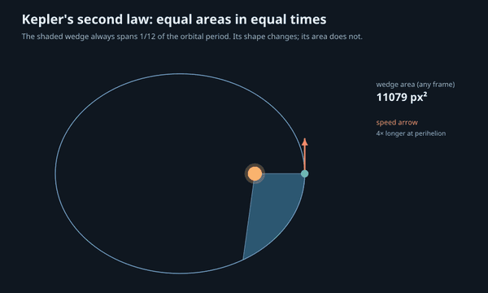 | 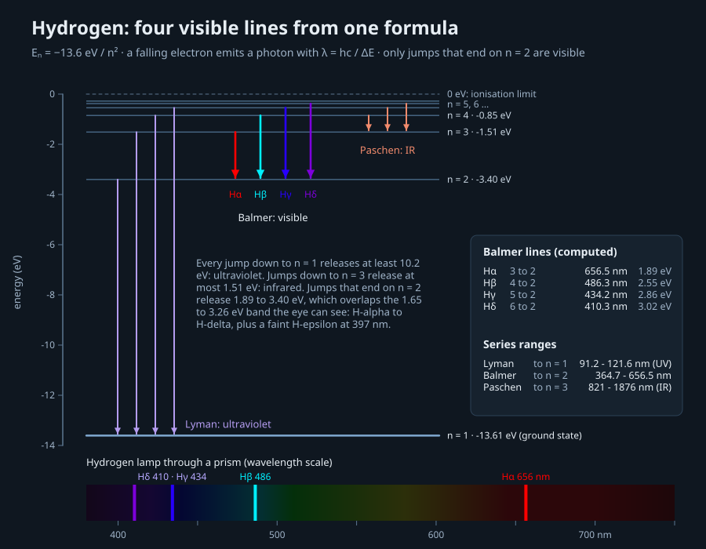 | 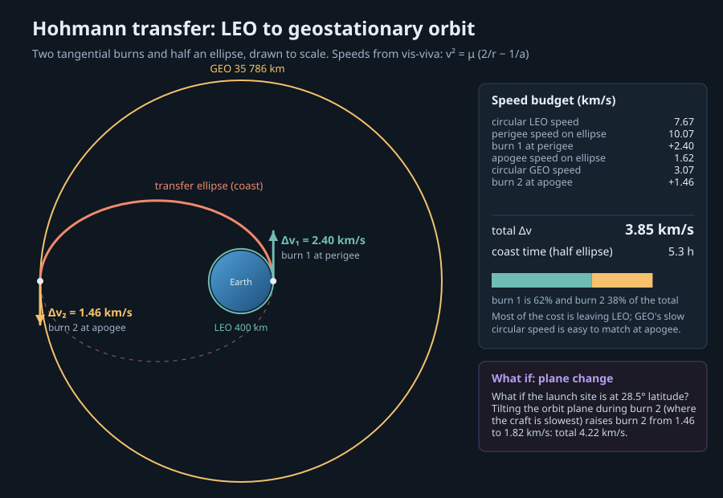 |
| Kepler's equation solved per frame: the wedge's shape changes, its area never does<br>`lmctl autorun https://raw.githubusercontent.com/lmctl-ai/lmdraw/main/examples/kepler-second-law.lms` | Bohr levels and the Rydberg formula explain why a hydrogen lamp shows four colours<br>`lmctl autorun https://raw.githubusercontent.com/lmctl-ai/lmdraw/main/examples/hydrogen-spectrum.lms` | Vis-viva gives 2.40 + 1.46 km/s; a 28.5° plane change costs 0.37 km/s more<br>`lmctl autorun https://raw.githubusercontent.com/lmctl-ai/lmdraw/main/examples/hohmann-transfer.lms` |

| Carnot engine P–V loop | Thin lens: real vs virtual image | Free-body diagram on a ramp |
| --- | --- | --- |
| 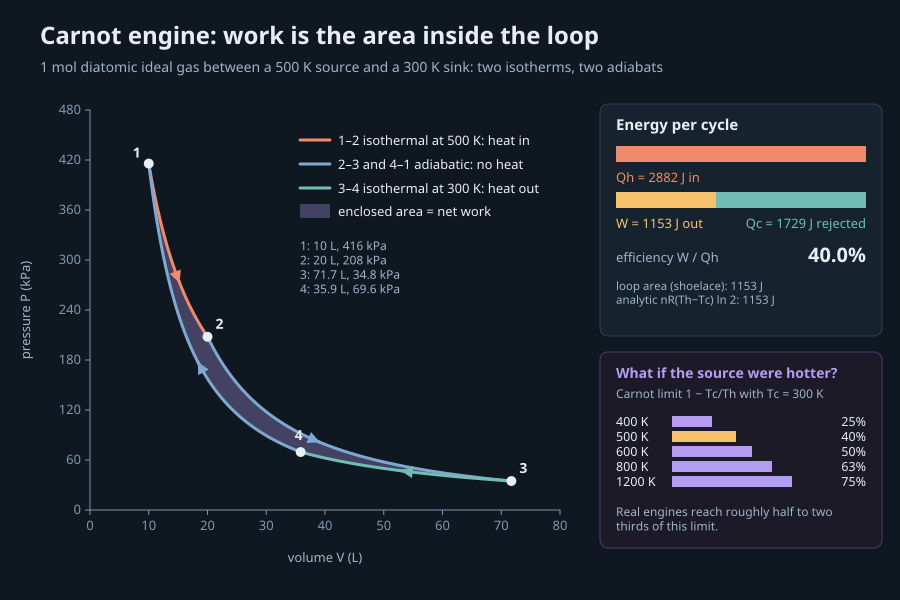 | 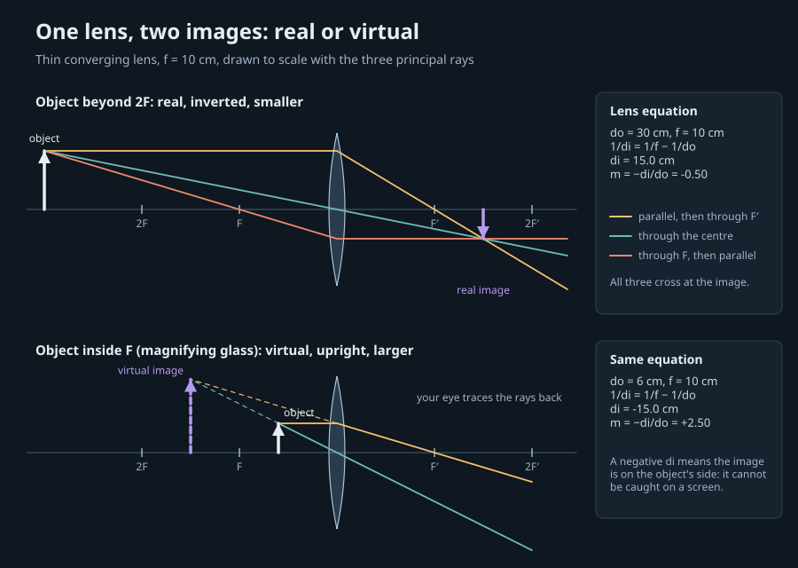 | 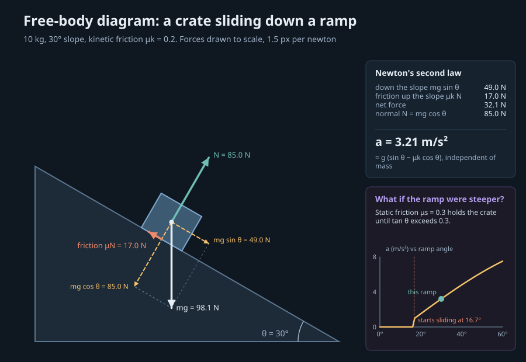 |
| Enclosed area equals the work, 1153 J; efficiency is 40 % = 1 − Tc/Th<br>`lmctl autorun https://raw.githubusercontent.com/lmctl-ai/lmdraw/main/examples/carnot-cycle.lms` | Three principal rays to scale: di = 15 cm (m = −0.5) and a 2.5× magnifier<br>`lmctl autorun https://raw.githubusercontent.com/lmctl-ai/lmdraw/main/examples/lens-ray-diagram.lms` | Forces drawn to scale give a = 3.21 m/s²; sliding starts at 16.7°<br>`lmctl autorun https://raw.githubusercontent.com/lmctl-ai/lmdraw/main/examples/incline-free-body.lms` |

### Engineering

| Pratt vs Howe truss | RC low-pass filter |
| --- | --- |
| 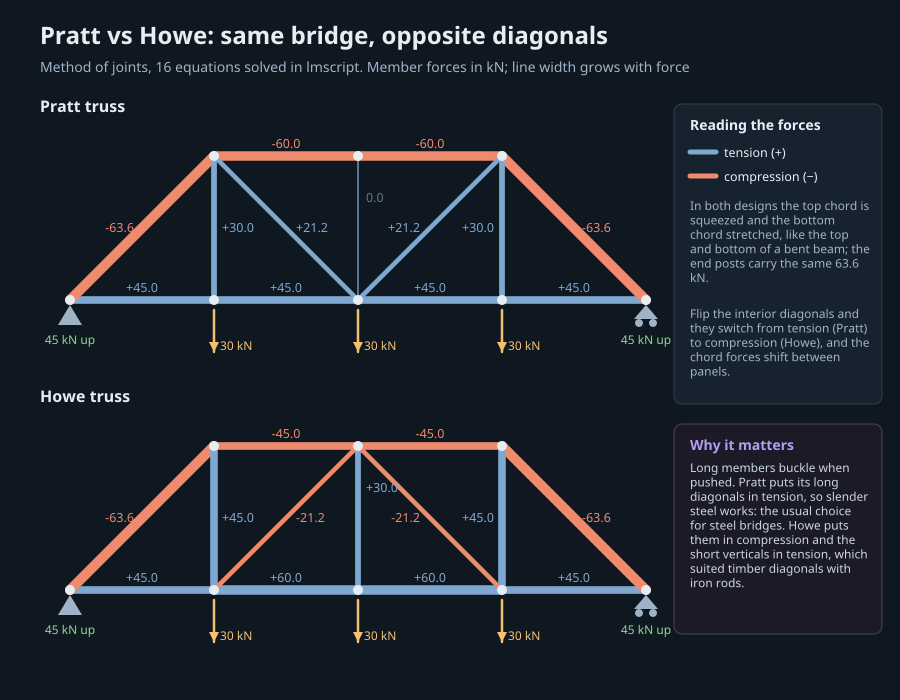 | 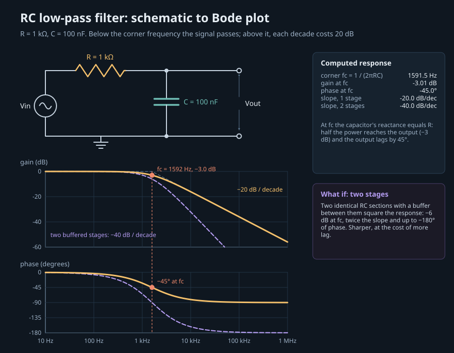 |
| Method of joints (16 equations): flipping the diagonals flips their force sign<br>`lmctl autorun https://raw.githubusercontent.com/lmctl-ai/lmdraw/main/examples/truss-bridge.lms` | Schematic to Bode plot: fc = 1591.5 Hz, −3 dB, −45°, −20 dB per decade<br>`lmctl autorun https://raw.githubusercontent.com/lmctl-ai/lmdraw/main/examples/rc-lowpass.lms` |

### Biology

| Predator–prey cycles | Mendel's 9 : 3 : 3 : 1 |
| --- | --- |
| 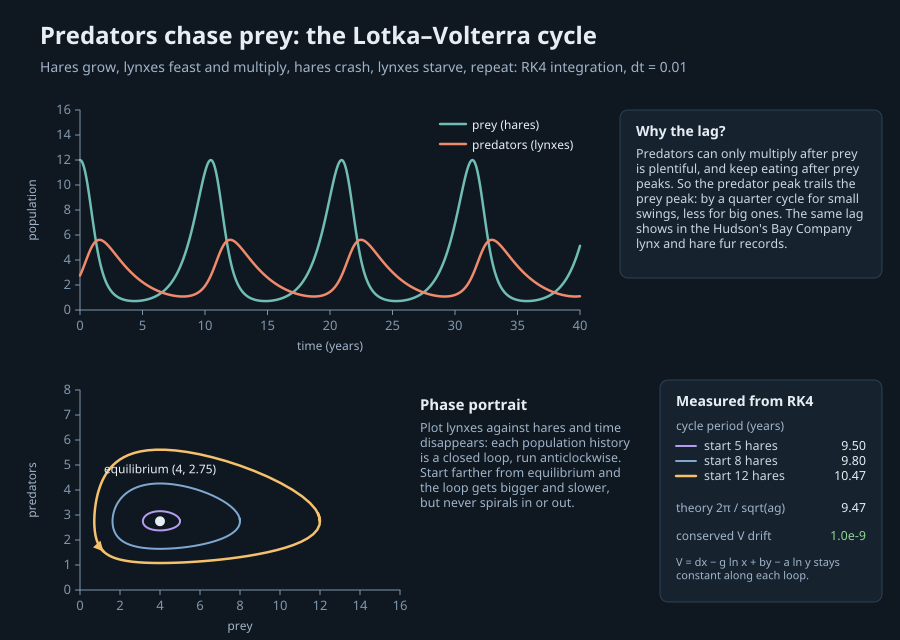 | 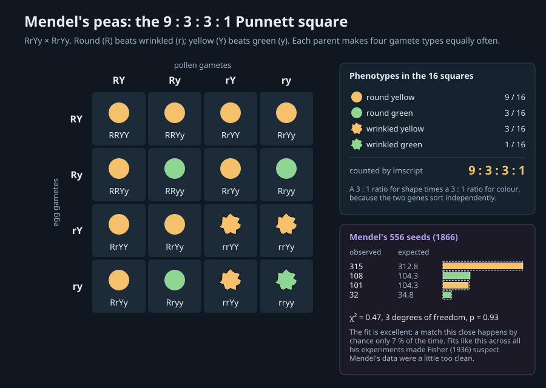 |
| RK4 Lotka–Volterra: predators lag prey; bigger swings have longer periods<br>`lmctl autorun https://raw.githubusercontent.com/lmctl-ai/lmdraw/main/examples/lotka-volterra.lms` | Dihybrid Punnett square; Mendel's 556 seeds fit with χ² = 0.47<br>`lmctl autorun https://raw.githubusercontent.com/lmctl-ai/lmdraw/main/examples/punnett-square.lms` |

### Finance

| Mortgage amortization | NPV, IRR and payback |
| --- | --- |
| 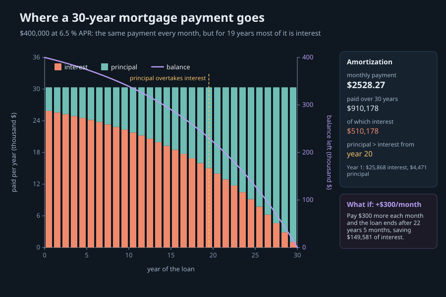 | 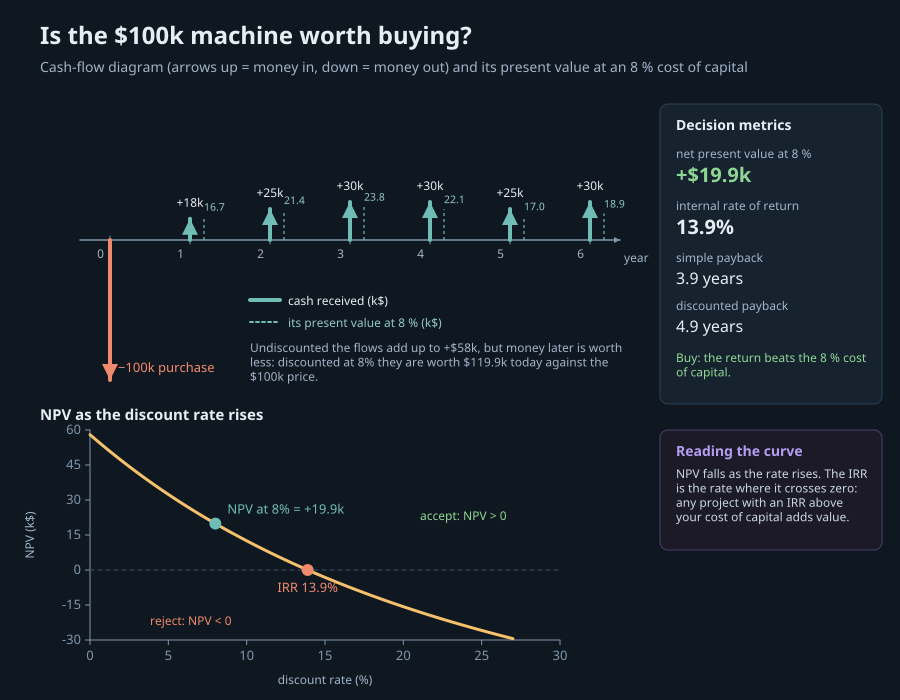 |
| $400k at 6.5 %: $510k of interest; +$300 a month saves $150k<br>`lmctl autorun https://raw.githubusercontent.com/lmctl-ai/lmdraw/main/examples/mortgage-amortization.lms` | Cash-flow diagram for a $100k machine: NPV +$19.9k at 8 %, IRR 13.9 %<br>`lmctl autorun https://raw.githubusercontent.com/lmctl-ai/lmdraw/main/examples/npv-irr-cashflow.lms` |

### Diagram toolkit

| Flowchart with wrapped labels | Imported SVG |
| --- | --- |
| 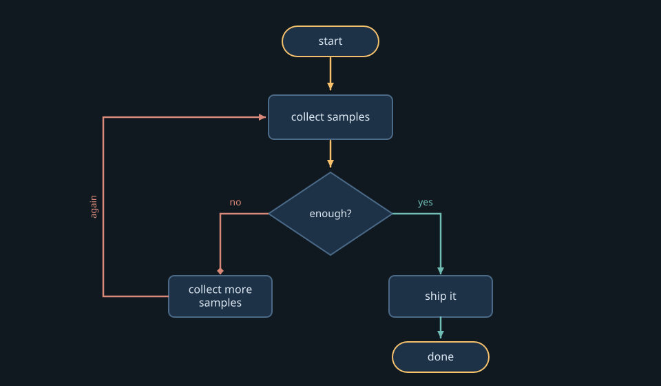 | 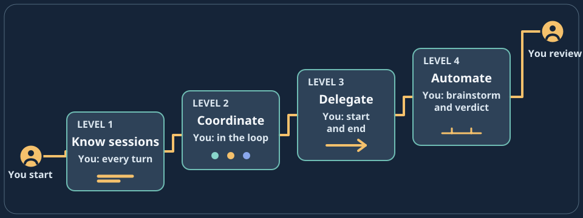 |
| Elbow edges, named markers, measured text wrapping<br>`lmctl autorun https://raw.githubusercontent.com/lmctl-ai/lmdraw/main/examples/decision-flowchart.lms` | Static SVG files load as retained, editable scenes<br>`lmctl autorun https://raw.githubusercontent.com/lmctl-ai/lmdraw/main/examples/render-assets.lms` |

All 25 examples, including the API tours (title card, nodes and groups, charts, heat map, tree, table, tweened frames), are listed in [examples/README.md](examples/README.md). `examples/render-all.sh` regenerates every picture above.

## Quick start (1 minute)

```sh
npm install -g @lmctl-ai/lmctl
lmctl autorun https://raw.githubusercontent.com/lmctl-ai/lmdraw/main/examples/hohmann-transfer.lms
```

The first run downloads the lmdraw release binary for your platform; the example then prints its computed answers and writes `images/hohmann-transfer.png` in the current folder. Every example runs the same way and finishes in a few seconds.

## Write your own

An lmdraw program is an lmscript file. Plain lmscript computes; the `_dsl_` block is compiled against lmdraw's typed schema and runs inside the native host.

```lmscript
mkdir("images");
mkdir("build/rendered");
v = sqrt(398600.4418 / 6778.137);                       # circular speed at 400 km
label = sprintf("LEO speed %.2f km/s", v);
p = _dsl_ cli="lmdraw" install="github:lmctl-ai/lmdraw@latest";
scene.canvas(640, 200, "#0f1720");
scene.circle(100.0, 100.0, 60.0, "#4f9fd8");
scene.arrow(170.0, 100.0, 300.0, 100.0, "#f5c16c", 3.0);
scene.text(320.0, 106.0, 22.0, ${label}, "#e6edf3");
scene.render_png("build/rendered/leo.png", 640, 200, 2);
end _dsl_
savedsl(p, "build/leo.dslb");
r = system ${dsl_cli(p)} --dsl build/leo.dslb;
assert(r.code == 0);
copy_file("build/rendered/leo.png", "images/leo.png");
```

The scene API: `canvas`, `rect`, `circle`, `ellipse`, `line`, `arrow`, `polyline`, `path` (SVG path data), `text` (with optional wrap width), `axes`, `group`, `image` (PNG data URI), `linear_gradient`, `load_svg`, `load_font`, `measure_text` and `render_png`; every node keeps SVG-style attributes (`set_attr`) and can be changed between frames. Run `lmdraw --dsl-schema` for the exact signatures and read [docs/LLM_GUIDE.md](docs/LLM_GUIDE.md) for attributes, limits and recipes.

## How it works

<picture>
  <source media="(prefers-color-scheme: dark)" srcset="docs/readme/architecture.png">
  <source media="(prefers-color-scheme: light)" srcset="docs/readme/architecture-light.png">
  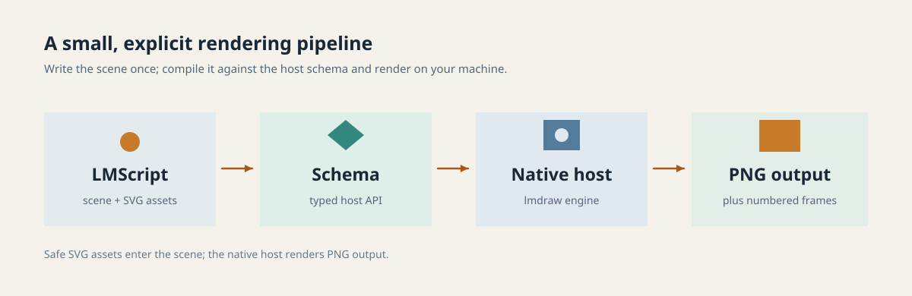
</picture>

lmdraw is a single static executable (LunaSVG/PlutoVG rasterizer, Noto Sans compiled in). It verifies the bytecode against its embedded schema before running anything, keeps a retained scene of nodes, and writes PNGs atomically. The same binary renders the same bytes on every run.

## Honest limits

- **PNG only.** No SVG or PDF export; animations are numbered PNG frames that you encode with ffmpeg (the GIF examples do this when ffmpeg is installed).
- **Output folders are fixed.** PNGs go directly under `build/rendered/` (and, from v0.2.4, `images/`); file inputs come only from `assets/` (SVG) and `assets/fonts/` (TrueType). Examples copy their PNG into `images/`.
- **Glyph coverage.** The embedded Noto Sans covers Latin, Greek and Cyrillic, sub/superscripts and common punctuation, but not arrows (→), ∞, ≤, ≥, ≈ or √. No complex-script shaping or right-to-left layout.
- **Not a plotting library.** `axes` draws linear ticks only; log scales, legends and curve fitting are done by hand in lmscript (see `rc-lowpass.lms`). For data-heavy charts use [lmplot](https://github.com/lmctl-ai/lmplot).
- **No filters.** No blur, drop shadow or radial-gradient constructor; imported SVG must stay within a static subset (no CSS, scripts or external references).
- **lmscript has no trig or log built-ins** outside the `_dsl_` block (the block itself has `sin`, `cos`, `sqrt`, `pow`); the examples carry short series implementations. Integral numbers cross into a `_dsl_` block as `int`, so pass coordinates as strings or compute them inside the block.
- Byte-identical output is promised for the same binary; different platforms may differ in the last bits of anti-aliasing.

## Build and test

Requires C11/C++17, CMake 3.24+, Ninja, Python 3 and Node.js 24+ with the published lmscript compiler (`npm install -g @lmctl-ai/lmctl`). ffmpeg is optional (GIF frames).

```sh
scripts/sync-sdk.sh --verify
cmake -S . -B build -G Ninja -DCMAKE_BUILD_TYPE=Release
cmake --build build --parallel 3
./test.sh                  # host checks, refusals, and every example self-run
examples/render-all.sh     # regenerate docs/images/
```

More: [get started](https://lmctl.com/tools/lmdraw/get_started.html) · [tool guide](https://lmctl.com/tools/lmdraw/guide.html) · [LMScript language docs](https://lmctl.com/tools/lmscript/skill.html) · [releases](https://github.com/lmctl-ai/lmdraw/releases)

## License

The lmdraw code is MIT licensed; see [LICENSE](LICENSE). Bundled components (LunaSVG and PlutoVG, MIT; Noto Sans, SIL OFL 1.1) and the runtime notices for the statically linked platform C/C++ libraries are listed in [THIRD_PARTY_NOTICES](THIRD_PARTY_NOTICES) and [licenses/](licenses/).

Made by **Lattice Systems LLC**.
