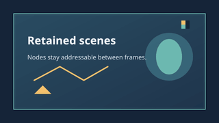
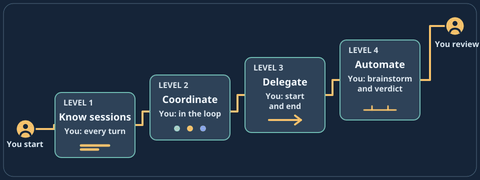
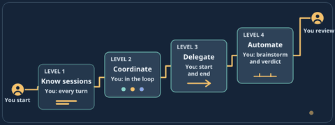

# Examples

All scripts are lmscript files with an embedded `_dsl_` block. Compile from the repository root and run the generated bytecode with `build/lmdraw --dsl FILE.dslb`. Outputs are written below `build/rendered/`.

- `title-card.lms` builds a card from shapes and text.
- `node-tour.lms` demonstrates retained nodes, groups, a linear gradient, path geometry, and text measurement.
- `render-assets.lms` loads and renders the six homepage SVG fixtures.
- `animated-ladder.lms` moves a retained node over 24 frames using `range`, `ease`, and `lerp`.

Compact preview renders are checked in under `renders/`. Recreate them with `scripts/render-previews.sh`; it uses lmdraw for rendering and ffmpeg to make palette-limited PNG previews.

See `../docs/LLM_GUIDE.md` for the complete API and safety limits.
